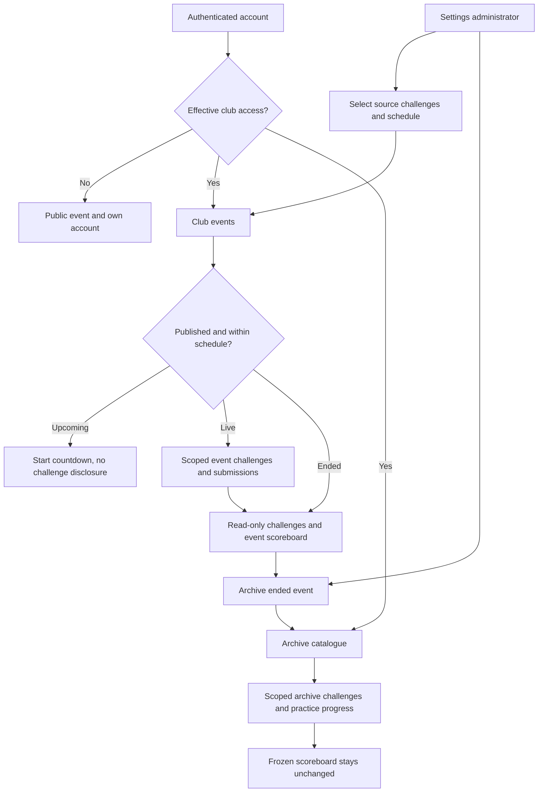

# Club membership and event archives

This extension preserves rCTF's authentication, current-event challenge flow, native scoring, and permission bits. Existing and newly registered accounts are **Guest** unless an administrator grants **Member** status. Guest accounts can participate in the current event. Membership grants access to past-event archives and practice; it grants no rCTF administrative permission.

## API

All routes use rCTF's standard `{kind, message, data}` response envelope. Typed routes and response schemas are exported from `@rctf/types`.

| Method and path                                                 | Access                          | Result                                                                          |
| --------------------------------------------------------------- | ------------------------------- | ------------------------------------------------------------------------------- |
| `GET /api/v2/club/access`                                       | Public, optional authentication | Role and effective club capabilities                                            |
| `GET /api/v2/club/members?search=&limit=50&offset=0`            | `usersWrite`                    | Search accounts and membership roles                                            |
| `PUT /api/v2/club/members/:id`                                  | `usersWrite`                    | Set `{ "role": "guest" }` or `{ "role": "member" }`                             |
| `GET /api/v2/club/archives`                                     | Member or club administrator    | Archive summaries                                                               |
| `POST /api/v2/club/archives`                                    | `settingsWrite`                 | Snapshot the closed current event; optional `{name, description}`               |
| `GET /api/v2/club/archives/:id`                                 | Member or club administrator    | Frozen public challenges and leaderboard, plus the caller's practice solved IDs |
| `POST /api/v2/club/archives/:id/challenges/:challengeId/submit` | Member or club administrator    | Check `{flag}` and return `correct`, `incorrect`, or `alreadySolved`            |

Club administrators with either `usersWrite` or `settingsWrite` can read archives without a membership grant. Only `settingsWrite` can create archives. Anonymous archive requests fail with `badToken`; Guest requests fail with `badPerms`. Archive handlers re-read membership, native permissions, and ban status from PostgreSQL for every request, so revocation takes effect on the next request even if rCTF's authentication cache is warm.

## Closing and archiving an event

The `/admin/club` screen manages memberships and the persistent `clubMode` setting. **Club** mode closes an active event and blocks scored flag submissions even if a future schedule remains in configuration. **Event** mode retains the schedule. **Open event** requires an explicit future end time, preserves an already-started event's original start time and scores, and opens a confirmation dialog explaining that behavior. **Close event** changes the native end time and leaves Event mode selected. Mode defaults to `event` for compatibility and requires `settingsWrite` to change. The public config refreshes every 15 seconds so other sessions observe changes.

Use the existing **Admin → Settings → End time** setting to close the event. rCTF's native submission route returns `badEnded` after this time. Archive creation returns `badClubEventActive` until the end time has passed.

An archive is a repeatable-read PostgreSQL snapshot of public challenges released before the event's end. It computes final challenge points, solve counts, team scores, and tiebreak ranks using rCTF's native scoring engine directly from solves in the original event interval (`startTime <= createdat < endTime`), independently of the asynchronous leaderboard worker. Solves from earlier events or after the end time are excluded. Hidden and unreleased challenges are omitted. Names, scores, ranks, and descriptions are copied, so later live-event edits do not change an archive. The operation does not clear current challenges, current solves, or current scores. No archive-update API is provided.

The archive stores an explicit public challenge representation and separate private static flags. Public API responses never serialize the flags, provider configuration, dynamic scoring secrets, instancer configuration, or admin-bot configuration. Literal static flags appearing in challenge names or descriptions are redacted. Private flags require the same database backup protection as current-event flags.

## Practice behavior and limitations

Static flags, including omitted provider names that default to `flags/static`, support replay. Multiple static flags are accepted. Challenges requiring instancers, admin bots, per-team flags, regex or other unsupported providers, or dynamic scoring feeds are visible with `practiceAvailable: false` and an English explanation. Unsupported practice submissions return `badClubPracticeUnavailable`.

Challenge file metadata and URLs are copied. Uploaded files and externally hosted challenge assets must remain available; archives do not duplicate remote files or provision retired services. Existing upload URL access rules remain unchanged.

Practice solves live only in `club_practice_solves`. A composite primary key makes concurrent correct submissions idempotent. Neither archive creation nor practice writes current-event solves, user scores, challenge scores, score events, or leaderboard caches. The frozen leaderboard is unchanged. Native flag rate limits apply with a separate archive/challenge key.

## Database and validation

Run `bun run db:migrate` to apply migrations 0029 and 0030. Membership/archive tables are: `club_memberships`, `club_archives`, `club_archive_challenges`, and `club_practice_solves`. Absence from `club_memberships` means Guest. No existing account or event data is rewritten.

Run `bun run test:server` for the native server suite, including `tests/server/tests/integration/club.test.ts`. The club tests use the existing PGlite PostgreSQL harness and real HTTP handlers to cover role assignment/revocation, direct API denial, event closure requirements, secret omission, authoritative scores before worker publication, original-event time scoping, immutable snapshots, default static flags and files, unsupported challenge types, concurrent solve idempotency, and practice score isolation. Run `bun run --filter '@rctf/types' --filter '@rctf/db' --filter '@rctf/api' typecheck` for the affected backend packages.

## Club screens

`/archive` is a searchable, internally scrolling event catalogue with caller-specific practice progress. Selecting an event opens `/challenges?archive=ID`; `/archive/:id` redirects there for compatibility. Standings have their own full-width `/scores/archive/:id` route. Guest and anonymous sessions receive a Members-only gate. `/admin/club` lists twenty accounts per page in an internally scrolling list with search and membership controls, event mode/schedule controls, and closed-event archive creation. Queries use session-scoped `club` keys, bounded retries, and a 15-second access refresh. Selected challenge and filters are URL state. Late responses after changing event, mode, access or login cannot update the new context.

## Private club events

Private events are independent from the public event and platform mode. Multiple published contests may overlap. `/club/events` is the member catalogue; `/challenges?event=ID` is its challenge workspace; `/scores/events/:id` contains its own standings. Admin navigation → Manage events opens `/admin/club/events`. Membership access matches archives; only `settingsWrite` can manage events. Drafts are visible only to settings administrators. Upcoming challenge contents are hidden from ordinary members.

| Method and path                                               | Access                       | Purpose                                            |
| ------------------------------------------------------------- | ---------------------------- | -------------------------------------------------- |
| `GET /api/v2/club/events`                                     | Member or club administrator | Visible event summaries                            |
| `POST /api/v2/club/events`                                    | `settingsWrite`              | Create an independent snapshot and schedule        |
| `GET /api/v2/club/events/:id`                                 | Member or club administrator | Event challenges, own solved IDs and standings     |
| `PATCH /api/v2/club/events/:id`                               | `settingsWrite`              | Update name, description, schedule and publication |
| `POST /api/v2/club/events/:id/challenges/:challengeId/submit` | Member or club administrator | Submit within a published event's time window      |
| `POST /api/v2/club/events/:id/archive`                        | `settingsWrite`              | Archive an ended event idempotently                |

Creation accepts selected `challengeIds` from the native bank or optional `sourceArchiveId`. Unsupported service-dependent/non-static challenges are rejected. Native points are frozen at the configured maximum; archive sources retain their snapshot points. Challenge source/content are immutable after creation. Start times cannot change after an event begins; an archived event cannot be edited. Before archiving, end time can be extended explicitly to reopen the same contest without resetting scores.

Migration 0030 adds `club_events`, `club_event_challenges` and `club_event_solves`. Solves use the composite `(event_id,user_id,challenge_id)` key. Submission, event edits and archiving serialize on the event row. Submissions recheck membership and enforce the database clock immediately in the insert (`start <= now < end`). Rate-limit keys include event and challenge IDs. Scores sum frozen challenge values, with earlier final solves breaking ties. Archiving freezes names/ranks/scores and copies supported challenges into the existing archive model, retaining a stable `archiveId` for idempotency. Practice begins independently from contest solves.

The public event still uses its native scoring path. This feature does not change the separately documented public in-flight closure limitation or provision retired challenge services. Preserve challenge assets and protect private flag tables in backups.

## Demo data

`bun run rctf seed-archives` adds three clearly marked fictional demo archives with distinct challenge sets. The command is idempotent and skips existing archive IDs without overwriting progress or snapshots. Its fixture answer keys are demonstration data, not production secrets. The local preview also contains two concurrent private events and one upcoming event created through the normal management API. Local demo IDs and credentials are ignored runtime state, not source configuration.

## Authorization hardening

Authenticated requests resolve the signed identity against PostgreSQL on each request; cached profile data no longer authorizes native API reads/writes. Native permission and start-bypass checks reject banned identities. Private handlers separately resolve effective membership and scope each query by event/archive ID. Bank-based event creation requires both settings management and native `challsRead`; archive-based creation remains available to settings administrators without bank read access. Practice checks access again after rate limiting and before persistence.

Regression tests in `auth-freshness.test.ts` cover stale cached rights, deleted identities, bans, current self-profile permissions, public-profile privacy and Guest public routes. Club tests additionally cover revocation during a delayed rate-limit operation. These checks do not substitute for production penetration/load testing. Assets served externally remain governed by their own access controls.
